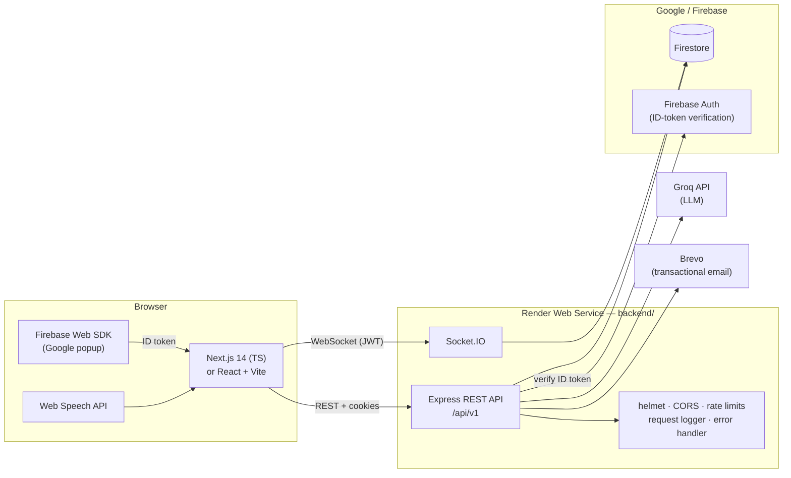
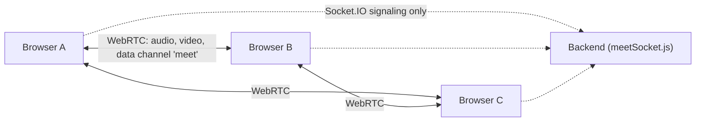

# 🌊 LinguaWave

> Speak a phrase, get instant word-by-word pronunciation feedback, practise with an AI tutor, track your progress and chat with other learners in real time.


---

## 📋 Table of Contents

1. [Overview](#1-overview)
2. [Features](#2-features)
3. [Architecture](#3-architecture)
4. [Tech Stack](#4-tech-stack)
5. [Repository Structure](#5-repository-structure)
6. [Getting Started](#6-getting-started)
7. [Environment Variables](#7-environment-variables)
8. [Authentication & Security](#8-authentication--security)
9. [API Reference](#9-api-reference)
10. [Socket.IO Events](#10-socketio-events)
11. [Data Model (Firestore)](#11-data-model-firestore)
12. [AI Integration](#12-ai-integration)
13. [Testing](#13-testing)
14. [Deployment (Render)](#14-deployment-render)
15. [Troubleshooting](#15-troubleshooting)
16. [Legacy Files & Cleanup Notes](#16-legacy-files--cleanup-notes)
17. [Meet (video rooms)](#17-meet-video-rooms)
18. [License](#18-license)

---

## 1. Overview

**LinguaWave** is a full-stack language-learning platform focused on **speaking**. A learner picks a language and difficulty, receives an AI-generated phrase, reads it aloud, and the app:

1. Transcribes the speech in the browser using the **Web Speech API**.
2. Sends the target phrase and the transcript to the backend.
3. Has an LLM (via **Groq**) score the attempt — overall accuracy, fluency, intonation, stress, phoneme-level issues, a per-word breakdown, and improvement tips.
4. Stores the result and updates the learner's streak, stats, charts and leaderboard position.

On top of that there is an **AI conversation tutor** with roleplay scenarios, **live community chat rooms** over Socket.IO, and a full authentication system (email + password with OTP verification, Google sign-in, password reset, refresh-token rotation, session management).

The backend is a modular monolith (Express + Socket.IO) backed by **Firebase Firestore**. There are **two interchangeable frontends** — Next.js 14 (TypeScript) and React + Vite (JavaScript) — that talk to the same API.

---

## 2. Features

| Area | What you get |
|------|--------------|
| 🎙️ **Pronunciation practice** | Daily AI-generated phrases per language × difficulty, live speech recognition, animated score ring, fluency / intonation / stress sub-scores, per-word status, phoneme table, AI suggestions |
| 🤖 **AI tutor** | Conversational partner with scenarios (e.g. Travel) and Easy / Medium / Hard modes; returns reply, translation, gentle correction, 0–100 score and encouragement |
| 📈 **Progress** | Accuracy trend charts (Chart.js), practice history with pagination, delete sessions |
| 🏆 **Gamification** | Streaks, total sessions / minutes, average accuracy, leaderboard (top 10) |
| 💬 **Community** | Real-time chat rooms (`global`, `english`, `french`, `spanish`), typing indicators, join/leave notices, online-user count, persisted history |
| 🔐 **Auth** | Email/password, 6-digit email OTP (bcrypt-hashed, lockout), Google sign-in via Firebase Auth, forgot/reset password, email verification, refresh-token rotation, "log out everywhere" |
| 🛡️ **Admin** | List users, change roles (`USER` / `ADMIN` / `MODERATOR`), platform stats, add languages |
| 🌍 **Languages** | English, French, Spanish, German, Japanese, Mandarin, Italian, Portuguese (BR) in the UI; the phrase API also supports Korean, Arabic, Russian and Hindi |
| 🧰 **Resilience** | Every AI feature has a deterministic fallback (mock analysis, demo tutor reply, built-in phrase bank) so the app works with **no API key** |

---

## 3. Architecture



**Why a modular monolith?** Auth, speech analysis, sessions and chat share middleware, rate limiting, one database and one deployment. Splitting them now would add network hops and operational overhead for no gain. The natural first seams to extract at scale are the **speech/AI service** (expensive, independently scalable) and **chat** (needs Redis pub/sub for multi-instance Socket.IO).

### Request lifecycle

`helmet → CORS → compression → body parsers (10 MB) → cookie-parser → morgan → requestLogger → general rate limiter → route → (authenticate → authorize) → validators → controller → errorMiddleware`

---

## 4. Tech Stack

| Layer | Technology |
|-------|------------|
| Runtime | Node.js 20 (pinned in `render.yaml`) |
| API framework | Express 4 |
| Real-time | Socket.IO 4 (JWT-authenticated handshake) |
| Database | **Firebase Firestore** via `firebase-admin` (modular API) |
| Social login | Firebase Authentication (Google) — ID token verified server-side |
| Auth tokens | `jsonwebtoken` (access + refresh + short-lived pre-auth), `bcryptjs` |
| Validation | `express-validator` |
| Security | `helmet`, `cors` (shared REST/Socket.IO policy), `rate-limiter-flexible`, `cookie-parser` (signed) |
| Email | Brevo transactional API |
| AI | Groq Chat Completions API (OpenAI-compatible) |
| Logging | Winston + Morgan, per-request IDs |
| Tests | Jest + Supertest + socket.io-client |
| Frontend A | Next.js 14 (App Router) + TypeScript, `react-chartjs-2` |
| Frontend B | React + Vite + React Router (JavaScript, 1:1 port of A) |
| Browser APIs | Web Speech API (`SpeechRecognition`) |
| Hosting | Render (backend + frontend web services, see `render.yaml`) |

---

## 5. Repository Structure

```
linguawave/
├── render.yaml                    # Render blueprint: backend + Next.js frontend
├── apply_merge.sh                 # Helper script for merging a "changed files" folder into a repo
│
├── backend/
│   ├── .env.example
│   ├── jest.config.js             # node env, 50% line-coverage threshold
│   ├── prisma/                    # ⚠ LEGACY (pre-Firebase PostgreSQL schema + migrations)
│   ├── tests/
│   │   ├── auth.test.js           # register / login / Google sign-in / health / 404
│   │   ├── integration.test.js    # frontend⇄backend contract + Socket.IO
│   │   └── meet.test.js           # Meet signaling, room cap, host actions, abuse guards
│   └── src/
│       ├── server.js              # HTTP server + Socket.IO + bootstrap + graceful shutdown
│       ├── app.js                 # Express app, middleware, route mounting
│       ├── config/
│       │   ├── env.js             # JWT secrets/TTLs (fails fast in production)
│       │   ├── cors.js            # one origin policy for REST + Socket.IO
│       │   ├── firebase.js        # Firestore + Auth init (3 credential strategies)
│       │   ├── passport.js        # ⚠ legacy Google OAuth2 strategy
│       │   ├── mongodb.js         # ⚠ legacy
│       │   └── postgres.js        # ⚠ legacy
│       ├── controllers/           # auth, speech, session, user, chat
│       ├── middleware/            # authMiddleware, rateLimiter, errorMiddleware, requestLogger
│       ├── models/
│       │   ├── firestore/         # ✅ active data layer (User, AuthSession, OtpRecord, ...)
│       │   └── mongo/             # ⚠ legacy Mongoose models
│       ├── routes/v1/             # auth, users, sessions, speech, chat, admin,
│       │                          # languages, conversation, phrases
│       ├── Services/emailService.js   # Brevo: welcome, OTP, verify, reset, password-changed
│       ├── sockets/socketManager.js   # chat, presence, session & feedback events
│       ├── sockets/meetSocket.js      # Meet: WebRTC signaling, rooms, host controls
│       └── utils/                 # jwtHelper, otpHelper, fetchRetry, logger,
│                                  # username, validation, fileStream (fs + zlib + streams)
│
├── frontend/                      # Next.js 14 + TypeScript (deployed by render.yaml)
│   ├── next.config.mjs            # redirects legacy backend-emitted URLs to new routes
│   ├── app/
│   │   ├── page.tsx               # landing + login / signup / OTP modal
│   │   ├── reset-password/
│   │   └── dashboard/             # layout (auth guard) · practice · tutor · progress
│   │                              # community · sessions · leaderboard
│   ├── components/                # AuthModal, charts, Icon, Logo, ui
│   └── lib/                       # api client, auth-context, config, firebase,
│                                  # phrases (offline bank), toast, useSpeech
│
└── frontend-react/                # React + Vite port (same UI, same CSS, same API calls)
    ├── vite.config.js             # dev & preview on :3000
    ├── public/{sign_model.json,hand_landmarker.task}   # on-device sign recognition assets
    └── src/{pages,components,lib,styles}   # Meet: pages/dashboard/Meet*.jsx, lib/meet/*, styles/meet.css

ml/                                # export_model.py + parity fixtures for the sign model
```

---

## 6. Getting Started

### Prerequisites

- **Node.js 20+** and npm
- A **Firebase project** with **Firestore** enabled and **Authentication → Google** provider turned on
- *(Optional)* a [Groq API key](https://console.groq.com/) — without it, AI features use built-in fallbacks
- *(Optional)* a [Brevo](https://www.brevo.com/) API key and verified sender — without it, emails are not sent and, in development, the OTP is printed in the server log.

### 6.1 Firebase setup

1. **Firestore**: Firebase console → *Build → Firestore Database → Create database*.
2. **Service account** (backend): *Project settings → Service accounts → Generate new private key*. Provide it to the backend in one of three ways (see [env vars](#7-environment-variables)):
   - paste the whole JSON on one line into `FIREBASE_SERVICE_ACCOUNT`, **or** base64-encode it:
     ```bash
     base64 -i serviceAccount.json | tr -d '\n'
     ```
   - set `FIREBASE_PROJECT_ID` + `FIREBASE_CLIENT_EMAIL` + `FIREBASE_PRIVATE_KEY`
   - set `GOOGLE_APPLICATION_CREDENTIALS` to a file path (or use the emulator)
3. **Web app config** (frontend): *Project settings → Your apps → Web app* → copy `apiKey`, `authDomain`, `projectId`, `appId`.
4. **Authorized domains**: *Authentication → Settings → Authorized domains* → add your deployed frontend domain.
5. **TTL policies** *(recommended)* — auto-delete expired documents:
   ```bash
   gcloud firestore fields ttls update expiresAt --collection-group=authSessions   --enable-ttl
   gcloud firestore fields ttls update expiresAt --collection-group=otpRecords     --enable-ttl
   gcloud firestore fields ttls update expireAt  --collection-group=pronunciationRecords --enable-ttl
   ```
   The code also checks expiry itself, because TTL deletion can lag by up to ~24 h.
6. **Indexes**: if a query needs a composite index, Firestore returns an error containing a one-click link to create it. Follow it once.

### 6.2 Backend

```bash
cd backend
npm install
cp .env.example .env        # then fill in the values (see §7)
npm run dev                 # http://localhost:5000
```

Health check: <http://localhost:5000/health> · API index: <http://localhost:5000/api>

> ℹ️ `package.json` files were not part of the source dump this README was generated from, so script names (`dev`, `start`, `test`) are taken from usage in `render.yaml` and the sub-READMEs. Adjust if yours differ.

### 6.3 Frontend — pick one

**Option A: Next.js (what `render.yaml` deploys)**

```bash
cd frontend
npm install
cp .env.example .env.local
npm run dev                 # http://localhost:3000
```

**Option B: React + Vite**

```bash
cd frontend-react
npm install
cp .env.example .env
npm run dev                 # http://localhost:3000
npm run build               # → dist/
```

Open <http://localhost:3000>, register an account, and (in dev, with no `BREVO_API_KEY`) copy the OTP from the backend console.

> 🎤 **Browser support:** speech recognition uses the Web Speech API (Chrome, Edge, Android). iOS Safari and other unsupported browsers automatically get a **typed-input fallback** on the Practice page.

---

## 7. Environment Variables

### 7.1 Backend (`backend/.env`)

| Variable | Required | Default | Description |
|----------|:--------:|---------|-------------|
| `PORT` | – | `5000` | HTTP port (Render injects it) |
| `NODE_ENV` | – | `development` | `production` makes missing JWT secrets fatal and enables secure cookies |
| `FIREBASE_SERVICE_ACCOUNT` | ✅* | – | Full service-account JSON (plain or base64) |
| `FIREBASE_PROJECT_ID` / `FIREBASE_CLIENT_EMAIL` / `FIREBASE_PRIVATE_KEY` | ✅* | – | Alternative to the above (`\n` in the key is handled) |
| `GOOGLE_APPLICATION_CREDENTIALS` | ✅* | – | Fallback: path to a credentials file / emulator |
| `JWT_ACCESS_SECRET` | ✅ prod | dev placeholder | Access-token signing key (legacy alias: `JWT_SECRET`) |
| `JWT_REFRESH_SECRET` | ✅ prod | dev placeholder | Refresh-token signing key |
| `JWT_PREAUTH_SECRET` | – | `<access secret>:preauth` | Key for OTP-step tokens (deliberately different, so they can't act as access tokens) |
| `JWT_ACCESS_TTL` | – | `15m` | Access-token lifetime |
| `JWT_REFRESH_TTL` | – | `30d` | Refresh-token lifetime |
| `SESSION_SECRET` | ✅ | – | Signs cookies |
| `GROQ_API_KEY` | – | – | Enables real AI; omitted ⇒ mock/demo responses |
| `GROQ_ANALYSIS_MODEL` | – | `openai/gpt-oss-120b` | Model for pronunciation analysis |
| `GROQ_MODEL` | – | `openai/gpt-oss-20b` | Model for tutor chat and phrase generation |
| `FRONTEND_URL` | ✅ | `http://localhost:3000` | Public frontend root (**no trailing path**); used in email links |
| `ALLOWED_ORIGINS` | ✅ prod | – | Comma-separated origins for **both** REST CORS and Socket.IO. `localhost` is auto-allowed outside production |
| `BREVO_API_KEY` | – | – | Transactional email; omitted ⇒ no email (OTP logged in dev) |
| `EMAIL_FROM` | – | – | Sender verified in Brevo |
| `RATE_LIMIT_WINDOW_MS` | – | `900000` | General limiter window |
| `RATE_LIMIT_MAX` | – | `600` | Requests per window per user/IP |
| `MEET_MAX_PEERS` | – | `3` | Max people per Meet room (WebRTC mesh: each browser keeps `n-1` connections) |
| `MEET_MAX_ROOMS` | – | `100` | Max simultaneous Meet rooms on this instance (memory guard) |
| `MEET_CREATE_LIMIT` / `MEET_CREATE_WINDOW_S` | – | `5` / `600` | Rooms one user may create per window |
| `MEET_TURN_URLS` / `MEET_TURN_USERNAME` / `MEET_TURN_CREDENTIAL` | – | – | Optional TURN relay (comma-separated URLs). Without all three only STUN is offered |
| `LOG_LEVEL` | – | `info` | Winston level |
| `GOOGLE_CLIENT_ID` / `GOOGLE_CLIENT_SECRET` / `GOOGLE_CALLBACK_URL` | – | – | Only for the **legacy** Passport strategy (not used by the current Firebase flow) |

\* Provide **one** of the three Firebase credential methods.

Generate strong secrets with:

```bash
node -e "console.log(require('crypto').randomBytes(48).toString('hex'))"
```

### 7.2 Next.js frontend (`frontend/.env.local`)

| Variable | Default (dev) | Description |
|----------|---------------|-------------|
| `NEXT_PUBLIC_API_URL` | `http://localhost:5000/api/v1` | REST base (include `/api/v1`) |
| `NEXT_PUBLIC_SOCKET_URL` | derived from API URL | Socket.IO server (backend root) |
| `NEXT_PUBLIC_FIREBASE_API_KEY` | – | Firebase web config |
| `NEXT_PUBLIC_FIREBASE_AUTH_DOMAIN` | – | `your-project.firebaseapp.com` |
| `NEXT_PUBLIC_FIREBASE_PROJECT_ID` | – | |
| `NEXT_PUBLIC_FIREBASE_APP_ID` | – | |

> `NEXT_PUBLIC_*` values are **baked in at build time** — redeploy after changing them.

### 7.3 Vite frontend (`frontend-react/.env`)

Same as above with the prefix `VITE_` (`VITE_API_URL`, `VITE_SOCKET_URL`, `VITE_FIREBASE_*`). `VITE_SOCKET_URL` defaults to `VITE_API_URL` without `/api/v1`. Meet uses both: REST for `/meet/ice`, Socket.IO for signaling.

---

## 8. Authentication & Security

### 8.1 Flows

**Email + password**

```
Register ──► user created (emailVerified=false) ──► OTP emailed ──► { requiresOtp, preAuthToken }
                                                                       │
                                  POST /auth/verify-otp { preAuthToken, otp } ◄─┘
                                                                       │
                                   access token (body + cookie) + refresh cookie
```

- **Login** with correct credentials:
  - **Email verified** → tokens are issued immediately.
  - **Email not verified** → a new OTP is emailed and `{ requiresOtp: true, preAuthToken, maskedEmail }` is returned; finish with `/auth/verify-otp`.
- Wrong email or wrong password both return the same `INVALID_CREDENTIALS` error (no account enumeration).

**Google sign-in** — the browser signs in with the Firebase Google popup and posts the **Firebase ID token** to `POST /auth/google`. The backend verifies it with Firebase Admin, requires provider `google` and a **verified** email, then creates the user or links an existing account. When linking to an *unverified* password account the stored password is wiped (pre-hijack defence).

**Token refresh**

```
Access token expires (15m) → POST /auth/refresh (httpOnly cookie)
  → refresh JWT verified → session looked up by SHA-256 hash in Firestore `authSessions`
  → token rotated → new access token returned
```

The frontend keeps the **access token in memory only** and de-duplicates concurrent refresh calls (rotating tokens would otherwise race). A short grace window tolerates replay of the previous cookie.

### 8.2 Tokens & cookies

| Token | Lifetime | Where | Notes |
|-------|----------|-------|-------|
| Access JWT | 15 min | Response body (`Authorization: Bearer`) + `accessToken` cookie | Used by REST and Socket.IO |
| Refresh JWT | 30 days | `refreshToken` (path `/`) and `lw_refresh` (path `/api/v1/auth`) cookies | Only a **SHA-256 hash** is stored server-side |
| Pre-auth JWT | short | Response body | Signed with a **separate secret**; cannot access protected routes |

### 8.3 OTP rules

- 6 digits, **bcrypt-hashed** (cost 10), valid **5 minutes**
- **5 wrong attempts ⇒ 15-minute block**; requesting a new code does not bypass the block
- Resend limited to **3 per 5 minutes per IP** (plus per-user logic in the controller)

### 8.4 Hardening checklist (implemented)

- `helmet`, compression, 10 MB body limit, `trust proxy` for Render
- Shared CORS policy for REST + Socket.IO; blocked origins simply get no CORS headers (never a 500)
- Rate limiting (in-memory): general **600 / 15 min**, auth **10 / min**, speech **30 / min**, OTP resend **3 / 5 min**; preflight `OPTIONS` never counted; `429` includes `Retry-After`
- Email addresses keep Gmail dots/sub-addresses (avoids duplicate accounts on Google sign-in)
- Username: 3–20 chars `[a-zA-Z0-9_]`; password: min 8 chars
- Server **refuses to start in production** without JWT secrets
- RBAC via `authorize('ADMIN')` / `authorize(['ADMIN','MODERATOR'])`
- Socket.IO rejects connections without a valid access token; room IDs validated (`^[\w-]{1,40}$`); chat content capped at 2000 chars
- LLM output is sanitised/normalised before it reaches the client (scores clamped to 0–100)

> ⚠️ Rate limiters and the Socket.IO presence map are **in-process memory**. Running more than one backend instance requires Redis (e.g. `rate-limiter-flexible` Redis store + the Socket.IO Redis adapter).

---

## 9. API Reference

**Base URL:** `http://localhost:5000/api/v1` · **Auth:** `Authorization: Bearer <accessToken>` (or the `accessToken` cookie)

**Response envelope**

```jsonc
// success
{ "success": true, "data": { ... } }
// error
{ "success": false, "error": "Human-readable message", "code": "MACHINE_CODE" }
```

Common codes: `VALIDATION_ERROR`, `INVALID_CREDENTIALS`, `INVALID_TOKEN`, `TOKEN_EXPIRED`, `OTP_INVALID`, `OTP_EXPIRED`, `OTP_BLOCKED`, `PRE_AUTH_EXPIRED`, `NOT_FOUND`, `DUPLICATE_KEY`, `INTERNAL_ERROR`.

### Auth — `/auth`

| Method | Endpoint | Auth | Description |
|--------|----------|:----:|-------------|
| POST | `/auth/register` | – | `{ email, username, password, nativeLanguage? }` → creates user, sends OTP |
| POST | `/auth/login` | – | `{ email, password }` → tokens, or `requiresOtp` for unverified accounts |
| POST | `/auth/verify-otp` | – | `{ preAuthToken, otp }` → completes login, sets cookies |
| POST | `/auth/resend-otp` | – | `{ preAuthToken }` → new OTP (rate limited) |
| POST | `/auth/google` | – | `{ idToken }` Firebase ID token → login / account link |
| POST | `/auth/refresh` | cookie | Rotate refresh token, return new access token |
| POST | `/auth/logout` | – | Revoke current session, clear cookies |
| POST | `/auth/logout-all` | ✅ | Revoke **all** sessions for the user |
| GET | `/auth/sessions` | ✅ | List active sessions (device / IP / last used) |
| GET | `/auth/verify-email/:token` | – | Email verification link |
| POST | `/auth/forgot-password` | – | `{ email }` → reset link by email |
| POST | `/auth/reset-password/:token` | – | `{ password }` (min 8 chars) |

### Users — `/users`

| Method | Endpoint | Auth | Description |
|--------|----------|:----:|-------------|
| GET | `/users/me` | ✅ | Current user with nested `activity` (e.g. `activity.streak.current`) |
| PATCH | `/users/profile` | ✅ | `{ nativeLanguage?, targetLanguages? }` |
| GET | `/users/leaderboard` | ✅ | Top 10 learners (with usernames) |

### Phrases — `/phrases`

| Method | Endpoint | Auth | Description |
|--------|----------|:----:|-------------|
| GET | `/phrases/daily?lang=fr&difficulty=beginner&refresh=1` | ✅ | AI phrases for a language × level, cached 24 h; `refresh=1` regenerates |
| GET | `/phrases/random?lang=&difficulty=` | ✅ | A random phrase for practice |

Unknown `lang` / `difficulty` values are coerced to safe defaults (never cached or sent to the LLM).

### Speech — `/speech`

| Method | Endpoint | Auth | Description |
|--------|----------|:----:|-------------|
| POST | `/speech/analyze` | ✅ | `{ targetText, transcribedText, language? }` (each ≤ 500 chars) → analysis (30/min) |
| GET | `/speech/history?page=&limit=` | ✅ | Paginated pronunciation records (limit ≤ 50) |
| GET | `/speech/accuracy-trend?days=30` | ✅ | Daily average accuracy (`days` 1–365) |

**Analysis response (shape)**

```jsonc
{
  "accuracy": 86, "overallAccuracy": 86,
  "fluencyScore": 82, "intonationScore": 79, "stressScore": 84,
  "suggestions": ["…"],
  "wordsBreakdown": [{ "word": "bonjour", "score": 92, "status": "good", "note": null }],
  "phonemeAnalysis": [{ "phoneme": "/θ/", "expected": "th", "spoken": "d", "score": 65, "issue": "substitution" }]
}
```

### Sessions — `/sessions`

| Method | Endpoint | Auth | Description |
|--------|----------|:----:|-------------|
| GET | `/sessions?page=&limit=&language=` | ✅ | Paginated list (limit ≤ 50) |
| POST | `/sessions` | ✅ | Save a completed session (see body below) |
| GET | `/sessions/:id` | ✅ | One session |
| DELETE | `/sessions/:id` | ✅ | Delete a session |

```jsonc
// POST /sessions
{
  "language": "fr",            // 2–10 chars
  "duration": 120,             // seconds, 0–86400
  "accuracy": 84.5,            // 0–100
  "wordsAttempted": 12,
  "wordsCorrect": 10,
  "transcript": "…",           // optional, ≤ 2000
  "feedback": "…"              // optional, ≤ 4000
}
```

Saving a session updates streak / language progress / profile totals and emits `session:completed` to the user's other devices.

### AI Tutor — `/conversation`

| Method | Endpoint | Auth | Description |
|--------|----------|:----:|-------------|
| POST | `/conversation/chat` | ✅ | `{ userMessage (≤1000), language, conversationHistory?, systemPrompt? }` → `{ reply, translation, correction, score, encouragement }` |

Only the last 6 history messages are sent to the model.

### Chat — `/chat`

| Method | Endpoint | Auth | Description |
|--------|----------|:----:|-------------|
| GET | `/chat/messages?roomId=global&page=&limit=` | ✅ | Room history (default room `global`, default limit 50) |
| POST | `/chat/messages` | ✅ | `{ content, roomId?, type? }` — persists and broadcasts to the room |

### Languages — `/languages`

| Method | Endpoint | Auth | Description |
|--------|----------|:----:|-------------|
| GET | `/languages` | – | List active languages |
| POST | `/languages` | ADMIN | `{ code, name, flag }` (409 on duplicate) |

### Admin — `/admin` (ADMIN only)

| Method | Endpoint | Description |
|--------|----------|-------------|
| GET | `/admin/users?page=&limit=` | List users (no secrets) |
| PATCH | `/admin/users/:id/role` | `{ role: "USER" \| "ADMIN" \| "MODERATOR" }` |
| GET | `/admin/stats` | User count, session count, top activity |

### Utility

| Method | Endpoint | Description |
|--------|----------|-------------|
| GET | `/health` | Liveness probe (used by Render) |
| GET | `/api` | Endpoint index |
| GET | `/meet/ice` | ICE servers for WebRTC (auth required): STUN always, TURN if configured |

---

## 10. Socket.IO Events

**Connect** with the access token:

```js
import { io } from 'socket.io-client';
const socket = io(SOCKET_URL, { auth: { token: accessToken }, withCredentials: true });
```

Connections without a valid token (or for a deleted user) are rejected.

### Client → Server

| Event | Payload | Description |
|-------|---------|-------------|
| `chat:join` | `roomId` | Join `room:<roomId>` |
| `chat:leave` | `roomId` | Leave the room |
| `chat:message` | `{ content, roomId = 'global' }` | Persist to Firestore and broadcast |
| `chat:typing` | `{ roomId, isTyping }` | Typing indicator |
| `session:start` | `{ sessionId }` | Join `session:<id>`; server replies `session:started` |
| `pronunciation:feedback` | `object` | Relayed to all of the user's devices |

### Server → Client

| Event | Payload | Description |
|-------|---------|-------------|
| `chat:message` | `{ id, userId, content, roomId, type, user, createdAt }` | New message |
| `chat:userJoined` / `chat:userLeft` | `{ userId, username, timestamp }` | Presence in a room |
| `chat:typing` | `{ userId, username, isTyping }` | Typing status |
| `chat:error` | `{ message }` | Failed to send |
| `users:online` | `number` | Distinct online users |
| `session:started` | `{ sessionId, timestamp }` | Ack for `session:start` |
| `session:completed` | `{ sessionId, accuracy, duration }` | Emitted after `POST /sessions` |
| `pronunciation:feedback` | `object + timestamp` | Multi-device feedback |

Every socket also auto-joins a private `user:<id>` room for targeted delivery.

**Meet events** (see [§17](#17-meet-video-rooms)):

| Direction | Event | Payload |
|-----------|-------|---------|
| → server | `meet:join` (ack) | `{ roomId, create }` → `{ ok, selfId, hostId, peers:[{id,name,userId}], max }` or `{ ok:false, error }` (`invalid-room`, `not-found`, `room-full`, `rate-limited`, `server-busy`) |
| → server | `meet:signal` | `{ to, data }` where `data` is `{type:'offer'\|'answer', sdp}` or `{type:'candidate', candidate}`; relayed to one peer in the same room |
| → server | `meet:leave`, `meet:end` | host-only for `end` |
| → server | `meet:kick`, `meet:mute` | `{ target }` (host only; `target` is a socket id) |
| ← client | `meet:peer-joined` / `meet:peer-left` | `{ id, name, userId }` / `{ id }` |
| ← client | `meet:signal` | `{ from, data }` |
| ← client | `meet:host-changed` / `meet:force-mute` / `meet:kicked` / `meet:ended` | `{ hostId }` / – / – / – |

---

## 11. Data Model (Firestore)

| Collection | Purpose | Notes |
|------------|---------|-------|
| `users` | Account, role (`USER`/`ADMIN`/`MODERATOR`), `googleId`, verification & reset token hashes, profile stats | Unique email/username enforced in code (transactional) |
| `authSessions` | One doc per refresh token: `tokenHash`, user agent, IP, provider, `expiresAt` | Hash only; TTL on `expiresAt` |
| `otpRecords` | `otpHash`, `attempts`, `blockUntil`, `expiresAt` | TTL on `expiresAt` |
| `userActivity` | Streaks, language progress, recent sessions | Powers leaderboard & dashboard |
| `practiceSessions` | Saved sessions: language, duration, accuracy, words, transcript, feedback | |
| `pronunciationRecords` | Full AI analyses (scores, phonemes, word breakdown) | **90-day** TTL on `expireAt` |
| `chatMessages` | Persistent chat history by `roomId` | |
| `languages` | `languages/{code}` (code is the doc ID ⇒ unique) | |

Profile fields kept on the user: `nativeLanguage`, `targetLanguages`, `totalSessions`, `totalMinutes`, `avgAccuracy`, `streak`, `lastActiveAt`.

---

## 12. AI Integration

All LLM calls go to **Groq's OpenAI-compatible endpoint** (`https://api.groq.com/openai/v1/chat/completions`) through `fetchRetry` (45 s timeout, 2 retries on network-level failures with backoff).

| Feature | Model (default) | Settings | Fallback when key missing / call fails |
|---------|-----------------|----------|----------------------------------------|
| Pronunciation analysis | `GROQ_ANALYSIS_MODEL` → `openai/gpt-oss-120b` | JSON-mode, `reasoning_effort: low` | Deterministic **mock analysis** |
| AI tutor | `GROQ_MODEL` → `openai/gpt-oss-20b` | temp 0.7, 500 tokens | **Demo reply** with the same `{reply, translation, score}` shape |
| Daily phrases | `GROQ_MODEL` → `openai/gpt-oss-20b` | temp 0.85, `reasoning_effort: low` | Built-in phrase bank (also bundled in the frontend) |

- Prompts demand **JSON only**; the server strips code fences, extracts the JSON object, validates required fields and clamps scores before responding.
- Phrases are cached **in memory for 24 h** per `(language, level)` key; only whitelisted values can form a key.
- Difficulty levels map to CEFR bands: Beginner ≈ A1–A2 (3–6 word sentences), Intermediate ≈ B1–B2 (6–12 words), Advanced ≈ C1–C2 (complex, idiomatic).
- Phrase generation supports: `en fr es de ja zh it pt ko ar ru hi`.

---

## 13. Testing

```bash
cd backend
npm test                      # all tests
npm test -- --coverage        # coverage (global threshold: 50% lines)
npm test -- --watch
```

Tests run with Firebase, models and e-mail **mocked** — no network or credentials needed.

| Suite | What it covers |
|-------|----------------|
| `auth.test.js` | Register validation, duplicate / race-condition `409`, OTP-on-register, login errors, **Google sign-in** (invalid token, non-Google provider, unverified email, new user, account linking, pre-hijack password wipe), `/health`, unknown route `404` |
| `meet.test.js` | **Meet**: create + join, 4th person gets `room-full`, `not-found` / `invalid-room`, signals reach only the target in the same room, malformed / oversized signals dropped, non-hosts cannot kick / mute / end, host kick, host handover, disconnect cleanup, 300-signals-per-10 s flood guard, per-user room-creation limit, garbage payloads never crash the server |
| `integration.test.js` | **Frontend ⇄ backend contract**: Gmail dots preserved, readable validation errors, OTP right/wrong + lockout can't be bypassed, pre-auth token can't be used as access token, `/users/me` shape, refresh rotation + grace replay, speech analysis without a key, session create → list, trend & leaderboard include usernames, tutor/phrase fallbacks, CORS preflight (allowed vs unknown origin), password-reset link, **Socket.IO** auth rejection and two-client room messaging |

**Frontend tests** (`frontend-react`, Vitest + jsdom): `npm test` runs the `useMeetRoom` hook tests (signaling order, ICE queueing, data channel, reconnect, host identity), the sign-model **parity test** (JS classifier vs. the Python reference in `ml/sign_model.fixtures.json`, tolerance 0.001), captioner and slow-device-guard unit tests, and a check that the MediaPipe WASM version in `signEngine.js` equals the exact pin in `package.json`.

**Manual smoke test**

```bash
curl http://localhost:5000/health
curl -X POST http://localhost:5000/api/v1/auth/register \
  -H 'Content-Type: application/json' \
  -d '{"email":"me@example.com","username":"me_user","password":"supersecret1"}'
# → { requiresOtp: true, preAuthToken: "…" }  (OTP is in the server log in dev)
```

---

## 14. Deployment (Render)

`render.yaml` defines two web services.

| Service | Root | Build | Start | Notes |
|---------|------|-------|-------|-------|
| `linguawave-backend` | `backend` | `npm install` | `npm start` | Health check `/health`; Node 20.18.0 |
| `linguawave-frontend` | `frontend` | `npm install --include=dev && npm run build` | `npm start` | `--include=dev` because `next build` needs TypeScript types; `NODE_OPTIONS=--max-old-space-size=460` keeps the build under the free plan's 512 MB |

**Checklist**

1. Create both services from the blueprint (*New → Blueprint*).
2. Backend secrets (`sync: false`): `FIREBASE_SERVICE_ACCOUNT`, `GROQ_API_KEY`, `BREVO_API_KEY`, `EMAIL_FROM`. JWT/session secrets are auto-generated.
3. Set `FRONTEND_URL` **and** `ALLOWED_ORIGINS` to the frontend's real public URL (Render may append a suffix like `-ab12`). No trailing slash or path.
4. Set `NEXT_PUBLIC_API_URL` (`…/api/v1`) and `NEXT_PUBLIC_SOCKET_URL` (backend root) on the frontend to the backend's real URL, plus the four `NEXT_PUBLIC_FIREBASE_*` values. **Redeploy the frontend** after any change.
5. Add the frontend domain to Firebase **Authorized domains**.
6. Free plan services sleep after ~15 min idle (cold starts) — use the `starter` plan to avoid this.

> The URLs in `render.yaml` (`linguawave-frontend.onrender.com`, `linguawave-backend-qk64.onrender.com`) are the author's deployment — replace them with yours.

**Deploying the Vite frontend:** build with `npm install && npm run build`, publish `dist/` as a static site, and add a rewrite `/* → /index.html` (`public/_redirects` and `vercel.json` are included for Netlify/Vercel).

**Cross-site cookies:** the refresh cookie is `httpOnly`, `secure` in production, and sent with `credentials: 'include'`, so the frontend origin **must** be in `ALLOWED_ORIGINS`. See [§17.5](#175-vercel--render) for the Vercel + Render case.

---

## 15. Troubleshooting

| Symptom | Likely cause / fix |
|---------|-------------------|
| Backend exits: `Missing required env var: JWT_…` | `NODE_ENV=production` without `JWT_ACCESS_SECRET` / `JWT_REFRESH_SECRET` |
| `FIREBASE_SERVICE_ACCOUNT is not valid JSON` | Paste the **whole** file as a single line, or base64-encode it |
| Firestore error with a long `https://console.firebase.google.com/…indexes…` link | Open the link and create the composite index |
| Browser CORS error / socket won't connect | Frontend origin missing from `ALLOWED_ORIGINS` (no trailing slash) |
| Logged out on every refresh in production | Cross-site cookie blocked — check `ALLOWED_ORIGINS`, HTTPS on both services, `trust proxy` |
| Email links point to the wrong page | `FRONTEND_URL` must be the frontend **root** (no `/index.html`) |
| No OTP email arrives | `BREVO_API_KEY` unset or `EMAIL_FROM` not a verified sender. In dev the OTP is printed in the server log |
| Google sign-in: "not configured" | `NEXT_PUBLIC_FIREBASE_*` / `VITE_FIREBASE_*` missing (they're read at build time) |
| Microphone does nothing | Unsupported browser (e.g. iOS Safari) — use the typed-input fallback; also check mic permission & HTTPS |
| AI results look generic | `GROQ_API_KEY` missing or call failed → mock/demo fallback is being served |
| `429 Too many requests` | Respect the `Retry-After` header; see limits in §8.4 |

---

## 16. Legacy Files & Cleanup Notes

The project was migrated from **MongoDB + PostgreSQL (Prisma)** to **Firebase Firestore**, and from a static HTML frontend to Next.js / React. Some leftovers remain and can be removed once you confirm nothing imports them:

| Path | Status |
|------|--------|
| `backend/prisma/**` (schema + 5 migrations), `backend/src/config/postgres.js` | Legacy PostgreSQL layer |
| `backend/src/config/mongodb.js`, `backend/src/models/mongo/**` | Legacy MongoDB layer |
| `backend/src/config/passport.js` | Legacy server-side Google OAuth; the app now uses Firebase ID tokens at `POST /auth/google` |
| `backend/test_email.js` | Old SMTP/nodemailer test — email now uses Brevo |
| `backend/output.txt` | Stray UTF-16 debug dump of an LLM response — safe to delete |
| `apply_merge.sh` | Generic merge helper (its comments refer to a different repo name) |
| `speechController` field `geminiResponse` | Name kept for DB compatibility; the provider is now Groq |
| Error handler branches for Mongo `11000` / Prisma `P2002`/`P2025` | No longer triggered by Firestore |

Also worth tidying: the in-app route comment on `/auth/verify-otp` says OTP is "mandatory after every login", but the controller only requires it for **unverified** accounts.

---

## 17. Meet (video rooms)

A video room inside the logged-in dashboard (`/dashboard/meet`). Up to **3 people** per room, any number of rooms. Besides the usual controls (mic, camera, screen share, chat, participant list, host mute / remove / end for everyone) it has two accessibility features: **live speech captions** and **sign-gesture captions**.

### 17.1 How it works



- **Peer-to-peer mesh.** Audio and video never touch the server. With 3 people each browser holds 2 peer connections. The server only relays SDP / ICE over the existing authenticated Socket.IO connection and enforces the room cap.
- **No glare.** The newcomer always sends the offers to people already in the room; existing members only answer.
- **Data channel `meet`** carries `{type:"caption", source:"speech", text, final}`, `{type:"caption", source:"sign", text}`, `{type:"chat", text}` and `{type:"state", mic, cam, signing}`. Chat is **not stored** anywhere and disappears with the meeting. Senders' names always come from the server, never from the message.
- **Room codes** look like `abc-defg-hij`, generated with `crypto.getRandomValues`. A room exists only while someone is in it. Joining a code that does not exist returns `not-found`; only "Start a meeting" creates rooms.
- **Screen share** swaps the video track with `RTCRtpSender.replaceTrack` (no renegotiation).

### 17.2 Captions

| | Speech captions | Sign captions |
|--|-----------------|---------------|
| Engine | Chrome Web Speech API (`useSpeech.js`) | MediaPipe HandLandmarker + a small MLP, both in the browser |
| Privacy | Chrome sends your audio to **Google's speech service** while it is on | Runs on your device; no video frame leaves the browser |
| Look | Name + text, white on dark | Amber line with a hand icon, plus a "Signing" badge on the tile |
| Expiry | After ~6 s of silence | After 4 s of no signing |

Sign mode loads the MediaPipe bundle only when switched on, reads the raw local `<video>`, draws the hand skeleton on a canvas over your tile, and switches itself off (with a toast) if frames keep taking too long (average > 150 ms over 30 frames). A small debug pill on your own tile shows the label, confidence and ms per frame. Sign mode pauses while the camera is off or you are sharing your screen. Chrome desktop is the supported target; other browsers degrade (for example no speech captions, but you can still read others').

### 17.3 Hardening

- Server validates everything: room-code format, boolean `create`, signal type and size (16 KB), target must be in the **same room**, host-only actions, and every listener is wrapped so a malformed payload cannot crash the process.
- Per-user limits (keyed by user id, so extra tabs or reconnects do not reset them): 5 room creations per 10 minutes, 30 join attempts per minute, 300 signals per 10 s per socket, and at most `MEET_MAX_ROOMS` rooms per instance.
- A rejected join never ejects you from the room you are already in.
- Accessibility: labelled, `aria-pressed` toggle buttons, a screen-reader live region that announces each person's caption once it is stable (the visible caption lines are `aria-hidden`), focus moves into the side panel / caption popover on open and back to its button on close or <kbd>Esc</kbd>, visible focus rings, `prefers-reduced-motion` respected.

### 17.4 Retraining the sign model

```bash
pip install pandas scikit-learn numpy
python ml/export_model.py <dataset.csv> frontend-react/public/sign_model.json
```

The CSV has 63 landmark columns (21 × x, y, z) plus a label column. The script trains an MLP with mirror and jitter augmentation, writes the weights as plain JSON, and writes `sign_model.fixtures.json` next to it. Move that file to `ml/` and run `npm test` in `frontend-react`: the parity test fails if the browser classifier disagrees with Python. The labels in `sign_model.json` are the words the app can recognise.

### 17.5 Vercel + Render

Zero-cost setup: frontend on Vercel (static build of `frontend-react`), backend on Render.

1. **Render (backend):** set `FRONTEND_URL` and `ALLOWED_ORIGINS` to the Vercel URL (no trailing slash or path). `ALLOWED_ORIGINS` is an **exact-match** list, so a Vercel preview URL (`*.vercel.app`) must be added explicitly. It applies to REST and Socket.IO.
2. **Vercel (frontend):** set `VITE_API_URL=https://<your-backend>.onrender.com/api/v1` and `VITE_SOCKET_URL=https://<your-backend>.onrender.com` (plus the `VITE_FIREBASE_*` values). They are baked in at build time, so redeploy after changing them. Keep the SPA rewrite `/* → /index.html`.
3. Add the Vercel domain to Firebase **Authorized domains**.
4. **Cold starts:** the free Render plan sleeps when idle, so the Meet lobby pings `/health` and shows "Waking server…". Starting a meeting right after a cold start can take a while.
5. **TURN (optional):** STUN alone fails for some strict NATs and corporate networks. Set `MEET_TURN_URLS`, `MEET_TURN_USERNAME`, `MEET_TURN_CREDENTIAL` to any TURN provider you choose. Check that provider's current terms and quotas yourself.

**Refresh-cookie check (no behaviour was changed).** `authController.js` sets the refresh cookie with `httpOnly: true`, `secure: isProd`, `sameSite: isProd ? 'none' : 'lax'`, so in production it is already `SameSite=None; Secure`, which is what a cross-domain Vercel + Render deployment needs. The access token is kept in memory on the client, as before. One limit remains: when the frontend (`*.vercel.app`) and backend (`*.onrender.com`) are different sites, the refresh cookie is a **third-party cookie**, and browsers that block those (Safari, Firefox strict mode, Chrome with third-party cookies blocked) will not send it, so those users are asked to sign in again when the 15-minute access token expires. The robust fix is to serve both from one registrable domain (for example `app.example.com` and `api.example.com`), which is a deployment choice rather than a code change.

### 17.6 Manual test checklist

1. Three browser profiles (ideally two networks) log in; A starts a meeting, B and C join with the code or link. Everyone sees and hears everyone.
2. A fourth profile gets "This meeting is full (3 people maximum)." A typo'd code gets "does not exist"; `abc` shows an invalid-code message.
3. Mic / camera toggles update the other tiles; the camera light goes off when the camera is off and after leaving.
4. Screen share shows on the others' screens; the browser's own "Stop sharing" bar ends it and restores the camera.
5. Chat arrives on both others; reload and confirm it is gone. Only the host sees Mute / Remove / End for all.
6. Host mutes B (B's mic goes off and B sees a toast). Host removes C (C sees "removed", others see C leave). Host leaves: another person becomes host. End for all: everyone is sent out.
7. Close a tab mid-call: the others see that person leave within seconds and the room stays usable.
8. Turn on "Caption my speech" in Chrome: the others see the line within about a second; it clears after ~6 s of silence. Turn sign mode on, make a trained sign: an amber line appears under your tile for everyone, clearing after 4 s.
9. Put the laptop to sleep or drop Wi-Fi briefly: "Reconnecting…", then the call is rebuilt.
10. Keyboard only: reach every control with Tab, open Chat (focus lands in the panel), <kbd>Esc</kbd> returns focus to the Chat button. With a screen reader, remote captions are announced.

---

## 18. License

MIT © 2026 LinguaWave — *(the previous README declared MIT; add a `LICENSE` file to the repo root to make it official).*
